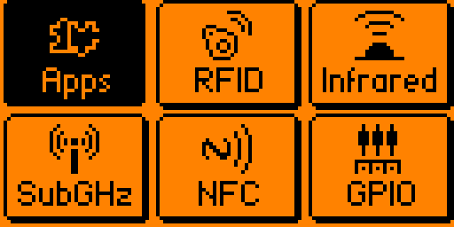

# flipper-zero-mcp

[](https://m8ven.ai/mcp/girishalpha-flipper-zero-mcp-1bouq7?s=readme)

A small MCP server that lets an AI agent (Claude Code, Claude Desktop, or any
MCP client) drive a Flipper Zero over USB: press buttons, see the screen, run
CLI commands, manage files, and capture radio/IR/RFID input.

It is a small, dependency-light Python package. No custom firmware, no companion
app on the Flipper, no extra hardware.



## What it can do

- **See and control the screen** — `flipper_screenshot` returns the display as a
  PNG; `flipper_navigate` and `flipper_press` send button presses and can
  return the resulting screen in the same call.
- **Run anything on the CLI** — `flipper_run_cli` for normal commands,
  `flipper_listen` for commands that run until interrupted (`subghz rx`,
  `ir rx`, `rfid read`, ...).
- **Manage files** — list, read, download, upload (MD5-verified), mkdir, delete.
- **Launch and close apps**, run JavaScript on the device, write and run BadUSB
  scripts, transmit saved Sub-GHz files, set the LED and vibration motor.
- **Diagnose itself** — `flipper_status` reports whether the Flipper is
  connected, the port is free, the CLI answers and the screen can be captured.
- **Survey before acting** — `flipper_index` gives one-call structural context
  (firmware, radio, SD tree); `flipper_find` locates files by name.
- **Remember what it learns** — a per-user, git-ignored `knowledge/` folder lets
  the agent save and reuse task notes with
  `flipper_kb_save` / `_list` / `_read` / `_search`, so similar future tasks
  start from prior work instead of scratch.

Full list: [docs/TOOLS.md](docs/TOOLS.md).

## Requirements

- Flipper Zero connected by USB
- Python 3.10+
- `pip install -r requirements.txt` (`mcp`, `pyserial`)

Tested on Windows 11 with Momentum firmware (mntm-012). It uses only the
standard Flipper CLI and RPC, so other firmware and operating systems should
work, but they have not been tested.

## Install

```bash
git clone https://github.com/girishalpha/flipper-zero-mcp.git
cd flipper-zero-mcp
pip install -r requirements.txt        # or: pip install -e .  (adds the `flipper-mcp` command)
python -m flipper_mcp --selftest
```

The self-test prints the device info and SD card status, then `self-test OK`.

You can start the server three equivalent ways:

```bash
python -m flipper_mcp          # preferred
flipper-mcp                    # after `pip install -e .`
python flipper_mcp_server.py   # legacy entry point, still supported
```

### Claude Code

```bash
claude mcp add flipper -- python /full/path/to/flipper_mcp_server.py
```

### Claude Desktop

Add to `claude_desktop_config.json`:

```json
{
  "mcpServers": {
    "flipper": {
      "command": "python",
      "args": ["/full/path/to/flipper_mcp_server.py"]
    }
  }
}
```

### Configuration

The serial port is found automatically by USB ID (`0483:5740`). To override it,
set the `FLIPPER_PORT` environment variable (for example `COM10` or
`/dev/ttyACM0`).

## Example

Ask the agent something like:

> Open the Infrared app on my Flipper and show me the screen.

It will typically call `flipper_status`, then `flipper_loader_open`, then
`flipper_screenshot`, and use `flipper_navigate(..., screenshot=True)` to move
through menus while watching the result.

## How it works

- The server opens the serial port for each tool call and closes it again, so
  it never blocks qFlipper or other tools between calls.
- Commands go through the Flipper's text CLI at 230400 baud.
- Screenshots use the Flipper's protobuf RPC: the server starts an RPC session,
  requests the screen stream, takes one 128x64 frame, stops the session and
  encodes the frame as a PNG. The few protobuf messages involved are
  encoded by hand, so no generated protobuf code is needed.

## Project layout

The server is split into a small helper core and one module per task domain, so
each capability has an obvious home and new ones are easy to add:

```
flipper_mcp/
├── app.py            shared FastMCP instance
├── server.py         wires the tools together + main()/--selftest
├── transport.py      Flipper serial session + port detection   ┐
├── protocol.py       hand-rolled protobuf decode                ├ helper core
├── imaging.py        framebuffer → PNG                          │
├── knowledge_base.py task-knowledge file helpers                ┘
└── tools/            one file per task domain
    ├── device.py   info, raw CLI, status, power, LED/vibro, listen
    ├── storage.py  list/read/download/upload/mkdir/delete
    ├── gui.py      press, navigate, unlock, screenshot
    ├── apps.py     loader open/close, launch .fap, run JS
    ├── survey.py   index, find
    ├── knowledge.py  kb_list/read/search/save
    ├── subghz.py   Sub-GHz transmit
    └── badusb.py   author + run DuckyScript
```

`flipper_mcp_server.py` at the repo root is a thin compatibility shim that keeps
older MCP configs working. **To add a new task domain** (e.g. NFC, RFID, IR,
GPIO), drop a `tools/<name>.py` that registers its `@mcp.tool()` functions and
add `"<name>"` to `_MODULES` in `tools/__init__.py`.

The `knowledge/` folder is per-user local memory: only its `README.md` and
`.gitignore` are committed — saved notes are git-ignored and never pushed.

## Development

```bash
pip install -e ".[dev]"
python -m pytest                           # or, with no extra dependencies:
python -m unittest discover -s tests
```

The tests need no Flipper: `tests/fakes.py` provides a fake serial port, so the
transport, protocol, imaging, knowledge base and tool logic all run offline.

Every tool declares MCP annotations (`readOnlyHint`, `destructiveHint`,
`idempotentHint`, `openWorldHint`) so clients can warn before risky calls. Pick a
preset from `flipper_mcp/app.py` when adding a tool, e.g.
`@mcp.tool(annotations=READ_ONLY)`; a test fails if a tool leaves them out.

## Things to know

- **A locked Flipper refuses screenshots.** On Momentum, RPC is blocked while
  the device is keypad- or PIN-locked. `flipper_unlock` clears a keypad lock.
- **Only one program can hold the serial port.** Close qFlipper and any
  lab.flipper.net browser tab before using this server.
- More in [docs/TROUBLESHOOTING.md](docs/TROUBLESHOOTING.md).

## Responsible use

This server gives an AI agent real control of a radio and HID device. Transmit
only on frequencies that are legal where you are, and only at devices you own.
Run BadUSB scripts only on computers you own or are authorised to test.

## License

MIT — see [LICENSE](LICENSE).
